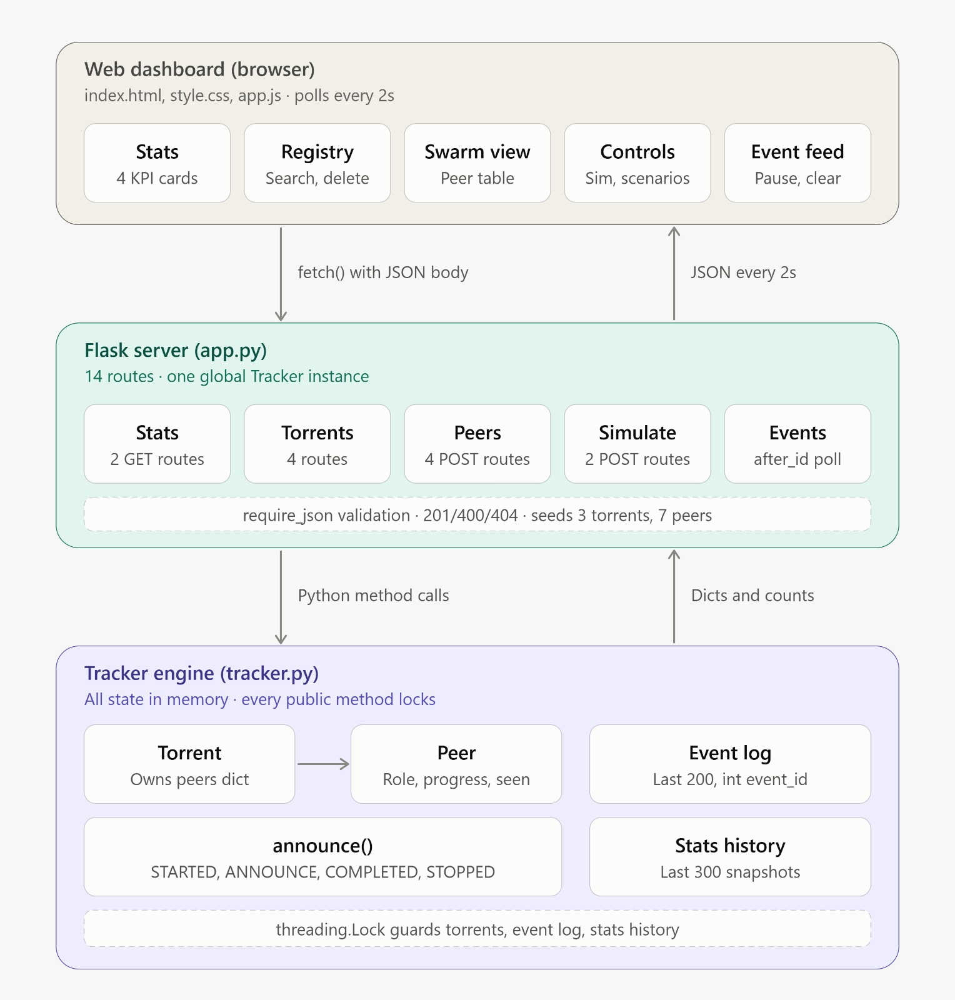

# Mini BitTorrent Tracker Simulator (Without Networking)

## 📌 Project Description

A simplified BitTorrent tracker simulator that demonstrates core P2P concepts — **trackers, swarms, seeders, and leechers** — without actual networking. The tracker maintains a registry of torrent files and their associated peer swarms. Peers can announce (join), leave, or be promoted from leecher to seeder when they complete a download. All swarm changes are displayed in real time through a professional monitoring dashboard.

> **Simulation note:** This project simulates tracker behaviour locally. There is no actual peer-to-peer data transfer or network communication between peers. All peers, torrents, and events exist in-memory on the server.

## ✅ Functional Requirements Covered

| Requirement | Status |
|-------------|--------|
| File → list of peers mapping | ✅ Torrent registry maps info hashes to peer swarms |
| Peers joining and leaving swarms | ✅ Announce (STARTED/STOPPED) and leave operations |
| Real-time seeder/leecher statistics | ✅ Live dashboard with 2-second polling |

## 🏗️ Architecture

The system follows a **three-tier client-server architecture** modelled after a real BitTorrent tracker.



**Components:**

- **Web Dashboard** — HTML/CSS/JS frontend that polls the API every 2 seconds for live swarm updates. Features a dark monitoring theme with stats cards, torrent registry table, swarm details with progress bars, simulation controls, and a real-time event stream.
- **Flask Web Server** (`app.py`) — REST API layer with 14 routes (13 API endpoints plus the dashboard page). Handles request validation, JSON routing, and HTTP error responses (400, 404). Seeds 3 demo torrents with 7 peers on startup.
- **Tracker Engine** (`tracker.py`) — Core logic with `Tracker`, `Torrent`, and `Peer` classes. Manages torrent registration, peer announce lifecycle, progress tracking, timeout expiry, and thread-safe event logging with incremental IDs.

## 🚀 How to Run

### Prerequisites

- Python 3.10+ (tested with Python 3.12 and 3.13)
- pip

### Setup & Run

```bash
# Clone the repository
git clone https://github.com/Aaditya210905/ds-project.git
cd ds-project

# Install dependencies
pip install -r requirements.txt

# Start the tracker
python app.py
```

Then open **http://127.0.0.1:5000** in your browser.

### On Ubuntu / Linux

```bash
git clone https://github.com/Aaditya210905/ds-project.git
cd ds-project
pip3 install -r requirements.txt
python3 app.py
```

## 📖 Usage

### Dashboard Sections

| Section | Description |
|---------|-------------|
| **Overview Cards** | Total torrents, active peers, seeders, leechers — updates in real time |
| **Torrent Registry** | Table of all registered files with info hash, peer counts, and actions |
| **Swarm Details** | Click a torrent row to see its peers, roles, and download progress bars |
| **Tracker Controls** | Register new torrents and add peers to swarms |
| **Simulation Controls** | Simulate random joins, leaves, progress ticks, and peer timeouts |
| **Event Stream** | Live feed of all tracker activity with event types and timestamps |

### How to Use

| Action | Steps |
|--------|-------|
| **Register a torrent** | Enter file name + size in the sidebar → click **Register Torrent** |
| **Add a peer** | Select a torrent, enter peer name, choose Seeder/Leecher → click **Join Swarm** |
| **View swarm** | Click any torrent row → swarm details panel shows all peers with progress |
| **Promote leecher → seeder** | Click the green **Complete ↑** button on a leecher peer |
| **Remove a peer** | Click the red **Leave** button on any peer |
| **Simulate progress** | Click **Sim Progress** to advance all leechers' download percentage |
| **Simulate timeout** | Click **Sim Timeout** to expire stale peers |
| **Run scenarios** | Use preset buttons: **Flash Crowd**, **Seeder Departure**, **Full Lifecycle** |

### Simulation Scenarios

| Scenario | What It Does |
|----------|--------------|
| **Flash Crowd** | 5 peers suddenly join a swarm at once (common in real torrents) |
| **Seeder Departure** | A seeder leaves the swarm, reducing availability |
| **Full Lifecycle** | Complete flow: register torrent → peers join → progress → complete → leave |

## 🗂️ File Structure

```
ds-project/
├── app.py              # Flask web server with REST API & validation
├── tracker.py          # Core tracker engine (Tracker, Torrent, Peer classes)
├── requirements.txt    # Python dependencies (flask>=3.0)
├── README.md           # Project documentation
├── group_details.txt   # Group info (number, names, roll numbers)
├── templates/
│   └── index.html      # Dashboard HTML template
└── static/
    ├── style.css       # Dark monitoring dashboard theme (1050+ lines)
    └── app.js          # Frontend logic: API client, rendering, simulation, scenarios
```

## 🔗 API Endpoints

| Method | Endpoint | Description |
|--------|----------|-------------|
| `GET` | `/` | Serve the web dashboard |
| `GET` | `/api/stats` | Global tracker statistics (torrents, peers, seeders, leechers) |
| `GET` | `/api/stats/history` | Stats snapshots over time (last 300, for charting) |
| `GET` | `/api/torrents` | List all tracked torrents with peer counts |
| `POST` | `/api/torrents` | Register a new torrent (body: `name`, `file_size`) |
| `GET` | `/api/torrents/<hash>` | Get torrent details and peer list (scrape) |
| `DELETE` | `/api/torrents/<hash>` | Remove a torrent and its entire swarm |
| `POST` | `/api/torrents/<hash>/announce` | Peer announce (body: `event` = STARTED/ANNOUNCE/COMPLETED/STOPPED; STARTED needs `peer_name`, optional `role`; other events need `peer_id`) |
| `POST` | `/api/torrents/<hash>/leave` | Peer leaves the swarm (body: `peer_id`) |
| `POST` | `/api/torrents/<hash>/promote` | Promote a leecher to seeder (body: `peer_id`) |
| `POST` | `/api/torrents/<hash>/progress` | Update a peer's download progress (body: `peer_id`, `progress` 0-100) |
| `POST` | `/api/simulate/progress` | Advance all leechers' download progress |
| `POST` | `/api/simulate/timeout` | Expire peers that haven't announced recently |
| `GET` | `/api/events?after_id=N` | Get tracker events after a given event ID |

## 📚 Distributed Systems Concepts Demonstrated

| Concept | Implementation |
|---------|----------------|
| **BitTorrent Tracker** | Central coordination server that maps files to peers (`tracker.py`) |
| **Swarm** | Per-torrent peer group with dynamic membership (join/leave) |
| **Seeders / Leechers** | Role-based peer classification — seeders have 100%, leechers are downloading |
| **Announce Protocol** | Full lifecycle: STARTED → periodic ANNOUNCE → COMPLETED → STOPPED |
| **Info Hash (20-byte)** | Protocol-compatible 40-hex-character identifiers using `secrets.token_hex(20)` |
| **Peer Identity** | Stable peer IDs with port, uploaded, downloaded, left, progress fields |
| **Scrape** | Query tracker for per-torrent swarm statistics |
| **Peer Timeout / Expiry** | Stale peers removed after inactivity window (120 seconds) |
| **Thread Safety** | `threading.Lock` protects shared state from concurrent API requests |
| **Event Streaming** | Incremental event IDs for reliable, gap-free event delivery to clients |

## 🎥 Demo Video

**Duration:** ≤ 5 minutes

| Timestamp | Segment |
|-----------|---------|
| 0:00 – 0:20 | Group members and project name |
| 0:20 – 1:20 | What the system does (tracker, API, dashboard) |
| 1:20 – 2:20 | Architecture diagram walkthrough |
| 2:20 – 4:20 | Live demo — register torrents, add peers, simulate progress, run scenarios |
| 4:20 – 5:00 | What we learned |

## ⚠️ Known Limitations

- **No actual networking** — all peers and transfers are simulated in-memory
- **No file chunking / piece selection** — progress is a single percentage
- **Single-server** — no distributed tracker or DHT
- **In-memory storage** — data is lost on server restart
- **No authentication** — open tracker (matches the simulation scope)

## 📄 License

This project was developed as a course assignment for Distributed Systems 2026.
