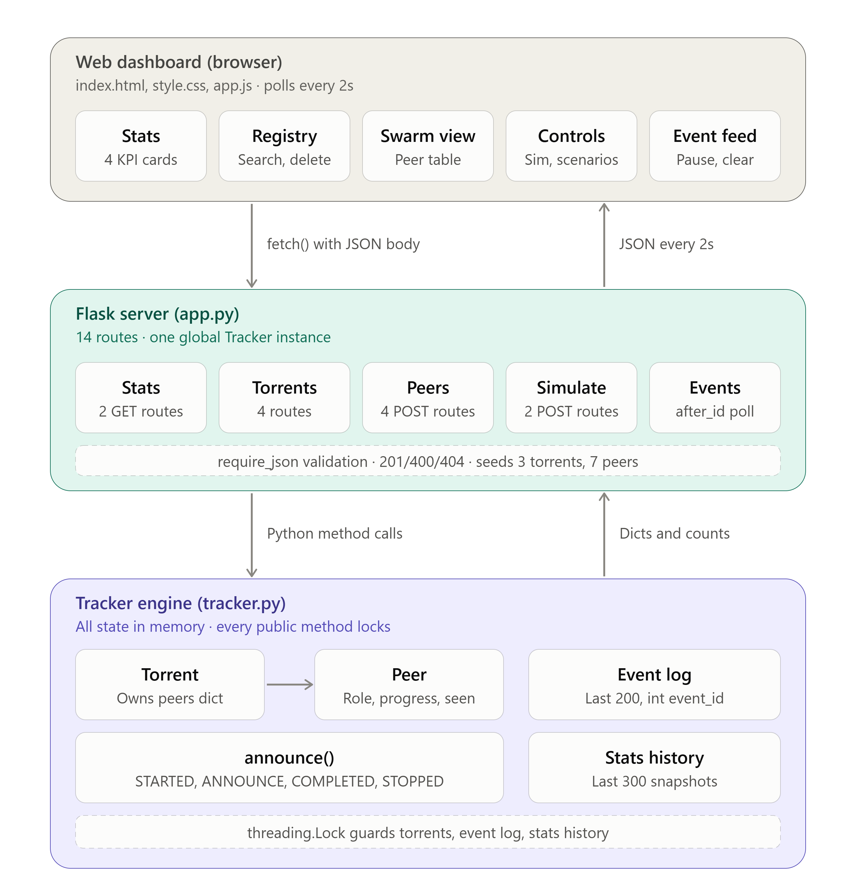

# 🎬 Demo Video Script — Mini BitTorrent Tracker Simulator

> **Total duration:** ~4:50  
> **Format:** Screen recording with voiceover  
> **Tip:** Have the app already running at `http://127.0.0.1:5000` before you start recording.

---

## 🟦 Segment 1 — Introduction (0:00 – 0:20)

> [!IMPORTANT]
> **Show:** A title slide (PowerPoint/Google Slides) or just the dashboard header with your group info overlaid.

### Script

> *"Hello, this is our group project for Distributed Systems 2026.*
>
> *Our project is **Mini BitTorrent Tracker Simulator — Without Networking**.*
>
> *Our team members are:*
> - *Aaditya Meghrajani — 241020401*
> - *Abhiudai Singh — 241020403*
> - *Abhinav Srivastav — 241020404*
> - *Aditya Tiwari — 241020405"*

**Duration:** ~20 seconds

---

## 🟦 Segment 2 — What the System Does (0:20 – 1:20)

> [!IMPORTANT]
> **Show:** The dashboard overview (stats cards, torrent table, event stream). Slowly scroll through it.

### Script

> *"In a real BitTorrent network, a **tracker** is the central server that keeps track of which peers are sharing a file. It doesn't transfer files itself — it simply maintains a **registry** of torrents and their associated **peer swarms**.*
>
> *Our simulator recreates this tracker behaviour entirely in-memory, without any actual networking.*
>
> *The system has three main parts:*
>
> *First, a **Tracker Engine** written in Python that manages torrent registration, peer swarms, and the announce lifecycle — STARTED, ANNOUNCE, COMPLETED, and STOPPED — just like the real BitTorrent protocol.*
>
> *Second, a **Flask REST API** that exposes endpoints for registering torrents, announcing peers, leaving swarms, and querying statistics.*
>
> *Third, a **real-time web dashboard** that polls the API every two seconds to display swarm state, peer progress, and an event stream — giving us a live monitoring view of tracker activity.*
>
> *The core functionality covers three things: mapping files to their peer lists, simulating peers joining and leaving swarms, and tracking real-time seeder and leecher statistics."*

**Duration:** ~60 seconds

---

## 🟦 Segment 3 — Architecture Diagram (1:20 – 2:20)

> [!IMPORTANT]
> **Show:** The architecture diagram image (`bittorrent_tracker_architecture.png`) full screen or on a slide. Point to each tier from top to bottom as you explain, and trace the arrows between them.

### Diagram to show:

### Script

> *"Here's our architecture. It follows a **three-tier client-server model**, inspired by how a real BitTorrent tracker works.*
>
> *At the top is the **Web Dashboard**, built with HTML, CSS and JavaScript. It has five parts: stats cards, the torrent registry, the swarm view, the simulation controls, and the live event feed. It sends `fetch` requests with JSON bodies to the server, and it polls for fresh data every two seconds.*
>
> *In the middle is the **Flask server**, `app.py`. It exposes 14 routes in five groups: stats, torrents, peers, simulation, and events. Every request goes through `require_json` validation, and bad input gets a clean 400 or 404 response. On startup it seeds three demo torrents with seven peers, so the dashboard is never empty.*
>
> *At the bottom is the **Tracker Engine**, `tracker.py`, the core of the project. A `Torrent` owns a dictionary of `Peer` objects, each with a role, a progress value, and a last-seen time. The `announce()` method handles the four protocol events: STARTED, ANNOUNCE, COMPLETED and STOPPED. Every change is written to an **Event Log** with incremental IDs, so the dashboard can ask for only what's new, and we keep **stats history** snapshots too.*
>
> *Everything lives in memory, and a single **threading Lock** guards the shared state, so concurrent API requests can't corrupt it."*

**Duration:** ~60 seconds

---

## 🟦 Segment 4 — Live Demo (2:20 – 4:20)

> [!IMPORTANT]
> **Show:** The running dashboard in the browser. Perform each action live and narrate what's happening.

### Part A — Overview (~15 sec)

> *"The dashboard loads with three pre-seeded demo torrents. At the top, you can see the overview cards showing 3 total torrents, 7 active peers, 4 seeders, and 3 leechers."*

**Action:** Point cursor at the stats cards.

---

### Part B — Register a New Torrent (~20 sec)

> *"Let me register a new torrent. I'll type a file name — 'my-project.zip' — and a size, say '500 MB'. Click Register."*

**Action:** Type `my-project.zip` in file name, `500 MB` in size, click **Register Torrent**.

> *"The torrent appears in the registry with a unique 40-character info hash — this matches the standard 20-byte identifier used in the real BitTorrent protocol. The total torrent count updates to 4."*

---

### Part C — Add Peers to the Swarm (~25 sec)

> *"Now let me add some peers. I'll select 'my-project.zip', add a peer named 'Alice' as a Seeder... and another peer 'Bob' as a Leecher."*

**Action:** Select the new torrent → type `Alice` → select Seeder → click **Join Swarm**. Repeat with `Bob` as Leecher.

> *"If I click on the torrent row, the swarm details panel below shows both peers. Alice is at 100% as a seeder, and Bob is downloading with a progress bar."*

---

### Part D — Simulate Progress & Promote (~25 sec)

> *"Let me simulate Bob's download progressing. I'll click the Simulate Progress button a few times."*

**Action:** Click **Sim Progress** button 2–3 times. Show Bob's progress bar increasing.

> *"Bob's progress is going up — 30%, 55%, now it's close to 100%. Once he finishes, I can promote him to a seeder by clicking the green Complete button."*

**Action:** Click **Complete ↑** on Bob.

> *"Bob is now a seeder — his badge changed from Leecher to Seeder, and the stats updated accordingly."*

---

### Part E — Run a Scenario (~20 sec)

> *"The dashboard also includes pre-built simulation scenarios. Let me run the 'Flash Crowd' scenario — this simulates five peers suddenly joining a swarm at once, which is a common pattern in real torrents."*

**Action:** Click the **Flash Crowd** scenario button.

> *"You can see multiple peers joined instantly. The event stream on the right shows all the PEER_JOINED events with timestamps."*

---

### Part F — Event Stream & Remove (~15 sec)

> *"The Event Stream panel records every tracker action — joins, leaves, promotions, registrations — with incremental event IDs. I can also remove a peer by clicking the red Leave button."*

**Action:** Click **Leave** on any peer. Point to the event stream.

> *"The peer is removed and a PEER_LEFT event is logged immediately."*

**Duration:** ~2 minutes total

---

## 🟦 Segment 5 — What We Learned (4:20 – 5:00)

> [!IMPORTANT]
> **Show:** Come back to the full dashboard overview, or switch to a closing slide.

### Script

> *"Through this project, we learned several key distributed systems concepts:*
>
> *First, we understood the **role of a tracker** in a BitTorrent network — it's not a file server, it's a coordination point that maps files to their peer swarms.*
>
> *Second, we implemented the **announce protocol lifecycle** — how peers go through STARTED, periodic ANNOUNCE, COMPLETED, and STOPPED states — which is fundamental to how trackers manage swarm membership.*
>
> *Third, we dealt with **thread safety** and **concurrent state management** — using locks to ensure multiple API requests don't corrupt shared data, which is a real challenge in distributed systems.*
>
> *And finally, we learned about **real-time event streaming** — using incremental event IDs instead of timestamps to reliably deliver events to clients, avoiding the problem of missed events with duplicate timestamps.*
>
> *Thank you for watching."*

**Duration:** ~40 seconds

---

## 📋 Quick Checklist Before Recording

- [ ] App is running: `python app.py` → open `http://127.0.0.1:5000`
- [ ] Browser is in **full screen** (F11) for a clean look
- [ ] Screen recorder is set to capture browser + audio
- [ ] Have a title slide ready (group name, project title, member names)
- [ ] Practice once before the final take
- [ ] Keep total video under **5 minutes**

> [!TIP]
> You don't need to memorize the script word-for-word. Read it naturally — paraphrasing is totally fine as long as you hit the key points in each segment.
